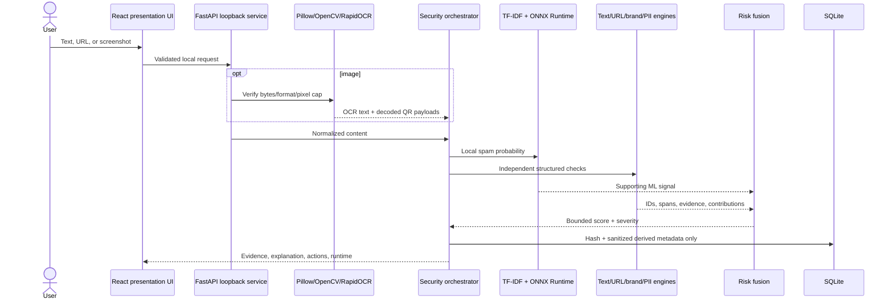

# Architecture

## Request and evidence flow

Image analysis is a real composition: defensive decode -> OCR -> text/URL analysis plus QR decode -> URL analysis -> PII -> risk fusion -> explanation. Demo assets traverse this same path; results are not hardcoded.

## Model/runtime boundary

TF-IDF vocabulary and IDF preprocessing remain in the local Python process. The resulting dynamic-batch `[batch,10264]` float32 matrix enters a 41,447-byte ONNX graph (`MatMul`, `Add`, `Sigmoid`). Provider selection is dynamic:

1. Use QDQ with QNN only if a verified Snapdragon report, `QNNExecutionProvider`, model filename, and exact SHA-256 all match; CPU fallback is disabled for that QNN session.
2. Otherwise prefer an available DirectML/CUDA provider for the FP32 model.
3. Use `CPUExecutionProvider` by default; a failed verified QNN initialization returns to this FP32 ONNX path.
4. If FP32 ONNX initialization also fails, load the serialized scikit-learn artifact locally.

The current machine selected CPU. Provider presence alone never changes Snapdragon validation to verified.

## Risk fusion and explainability

Every detector emits a stable ID, name, severity, description, sanitized evidence, optional source span, and expert-authored contribution. Positive contributions are summed and capped at 100. A single finding receives a 0.82 corroboration discount; weak totals below 28 receive a 0.78 adjustment when the ML probability is benign. Bands are 0-24 low, 25-49 moderate, 50-74 high, and 75-100 critical.

These weights are heuristic policy, not learned probabilities. The 18-case adversarial suite guards intended calibration. Explanations cite the strongest exact description/evidence and up to two supporting findings.

## Privacy boundary

The service binds to loopback. Raw content exists in browser/request memory while being analyzed but is not written to logs or SQLite. Stored incidents contain a SHA-256 input hash, timestamp, type, score, severity, classification, category, provider, latency, model version, and sanitized signal metadata. Uploaded source images are not persisted.

## Security boundaries

- Host allowlist, local-origin enforcement, restrictive CORS, CSP, `nosniff`, and no-referrer headers.
- Pydantic text limits; URL scheme validation; no DNS, fetch, navigation, expansion, or execution.
- 10 MiB image byte cap, 25-megapixel decoded cap, allowed MIME/decoded formats, and Pillow verification before native OCR/QR processing.
- Demo asset filename allowlist and resolved static-path containment; unknown normalized API routes return 404 instead of the SPA.
- Parameterized SQLite statements and React escaped rendering (no `dangerouslySetInnerHTML`).

Residual risks include local malware, native codec/model-parser flaws, resource exhaustion without a global multi-user rate limiter, OCR errors, and detector evasion.
