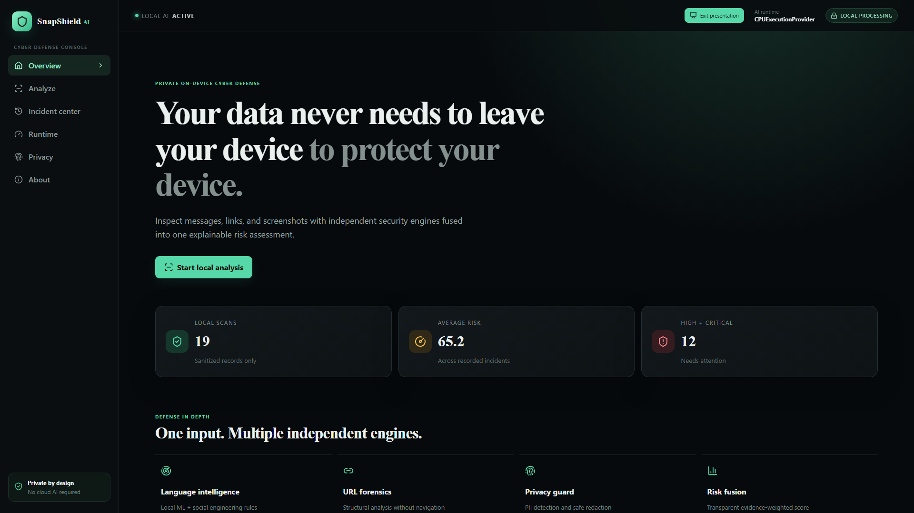
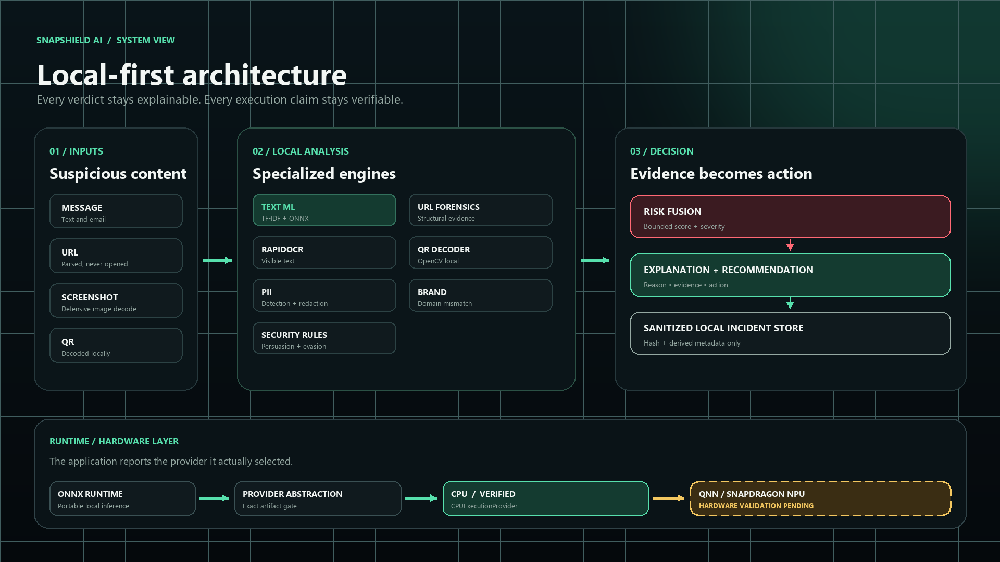
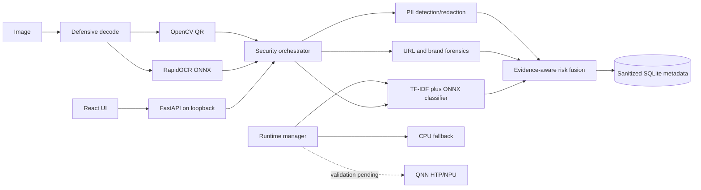
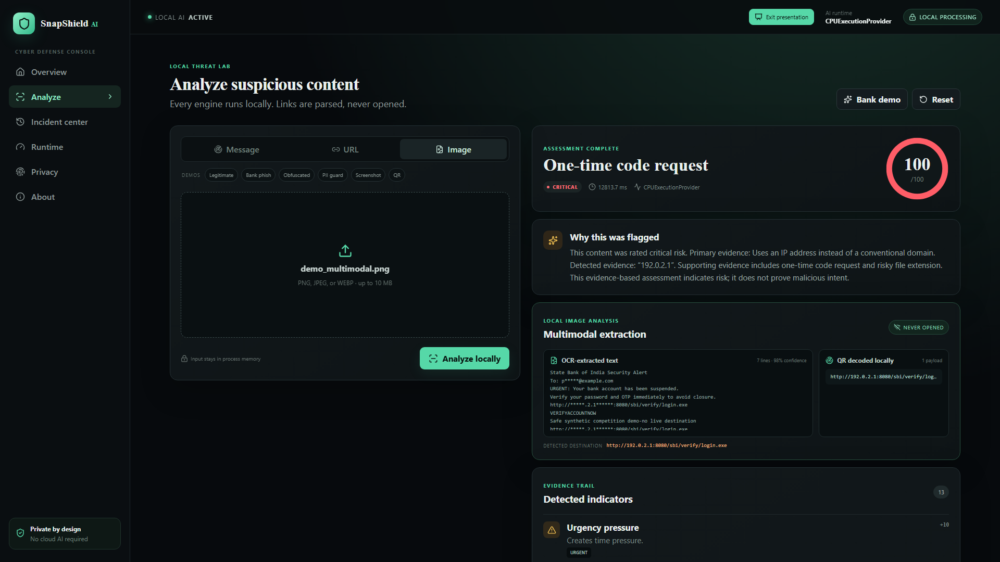
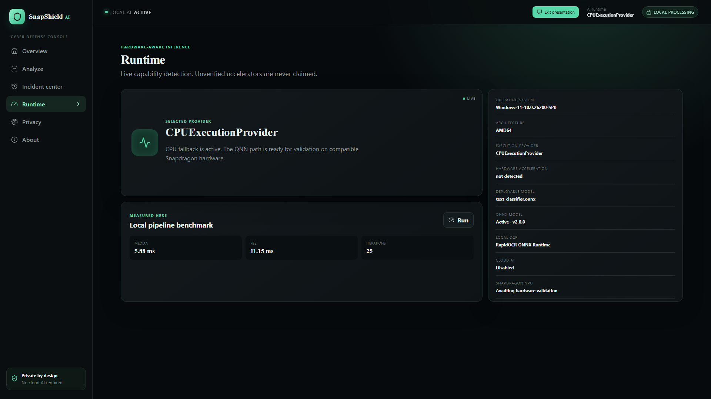

# SnapShield AI

> Private messages, links, and screenshots can be inspected without sending them to a cloud service.

SnapShield AI is a local-first, multimodal cyber-defense assistant for Windows and Snapdragon PCs. It combines a trained spam classifier, URL forensics, OCR, QR decoding, brand-impersonation checks, PII redaction, and transparent risk fusion. The application stores only hashes and sanitized incident metadata.

This repository is a working competition build. All analysis paths run locally after installation. It never visits submitted URLs, performs DNS lookups, executes payloads, or calls a cloud AI API.

**Verified now:** ONNX Runtime with `CPUExecutionProvider`, 77 passing backend tests, and 98.17% held-out accuracy on the deduplicated UCI SMS Spam Collection. The Snapdragon/QNN deployment path is implemented; hardware validation is pending.



## Competition submission

Start with the canonical [submission facts](SUBMISSION_FACTS.md), then use the [final submission package](docs/final_submission/01_PROJECT_FACTS.md), [presentation content](docs/final_submission/06_PRESENTATION_CONTENT.md), [exact demo script](docs/final_submission/10_DEMO_SCRIPT.md), and [80-question judge defense](docs/final_submission/20_JUDGE_QA_FINAL.md). For setup, see [QUICKSTART.md](QUICKSTART.md).

## Verified capabilities

- Reproducible UCI SMS Spam Collection pipeline with checksum validation, pre-split exact/near deduplication, seeded stratification, and an untouched 766-message test set.
- Three evaluated lightweight candidates; final word TF-IDF/logistic model selected using recall, macro F1, FPR, size, latency, ONNX compatibility, and local deployment suitability.
- Primary inference through ONNX Runtime with dynamic provider discovery and a tested scikit-learn fallback.
- Local RapidOCR/ONNX Runtime text extraction from PNG, JPEG, and WEBP screenshots.
- Local OpenCV QR decoding; decoded URLs are analyzed but never opened.
- URL, text, Unicode-obfuscation, controlled brand/domain mismatch, and PII engines.
- Evidence-led score, suspicious spans, explanations, recommendations, and privacy-minimal SQLite incidents.
- React/TypeScript presentation mode with one-click real demo inputs and a truthful AI Runtime panel.
- Unsigned Windows one-folder build in `release/SnapShieldAI`.

## ML result

The final model is `SnapShield UCI SMS Word TF-IDF Logistic Regression` v2.0.0. On the untouched 766-message test split it achieved:

Dataset attribution: **UCI SMS Spam Collection**, DOI [`10.24432/C5CC84`](https://doi.org/10.24432/C5CC84), licensed under **Creative Commons Attribution 4.0 (CC BY 4.0)**. See [DATASETS.md](DATASETS.md) for provenance, checksum, deduplication, and split details.

| Metric | Result |
|---|---:|
| Accuracy | 98.17% |
| Spam precision | 97.50% |
| Spam recall | 86.67% |
| Spam F1 | 91.76% |
| Macro F1 | 95.37% |
| Weighted F1 | 98.13% |
| False-positive rate | 0.30% (2/676) |
| False-negative rate | 13.33% (12/90) |
| ROC-AUC | 0.9928 |
| PR-AUC (average precision) | 0.9722 |

Confusion matrix, rows actual `[ham, spam]`: `[[674, 2], [12, 78]]`. These are SMS spam metrics, not a claim of production phishing detection accuracy. See [MODEL_CARD.md](MODEL_CARD.md).

## Architecture



<details>
<summary>Text version of the architecture</summary>



</details>

Detailed boundaries are in [ARCHITECTURE.md](ARCHITECTURE.md).

## Real multimodal evidence

The bundled synthetic screenshot is defensively decoded, read by local OCR, checked for a QR payload, and fused with text, URL, PII, brand/domain, and security-rule evidence. The decoded destination is displayed for inspection and is never opened.



## Quick start

Requirements: Python 3.11+ and Node.js 20.19+ or 22.12+.

```powershell
python -m pip install -r requirements.txt
cd frontend
npm install
npm run build
cd ..
python -m uvicorn backend.app.main:app --host 127.0.0.1 --port 8000
```

Open <http://127.0.0.1:8000>. For the built package, run `release/SnapShieldAI/SnapShieldAI.exe`; it binds only to `127.0.0.1:8765`. The package is not code-signed.

## Reproduce data, model, ONNX, and evaluation

```powershell
python ml/data/prepare_uci_sms.py
python ml/training/train_text_classifier.py
python ml/export/export_onnx.py
python scripts/evaluate_security_cases.py
python scripts/benchmark.py
python scripts/snapdragon/validate_snapdragon.py
```

The data step downloads only the official pinned UCI archive. Training selects on validation data, retrains on train+validation, and touches the test set once for the final report. The ONNX export compares every held-out test prediction with the scikit-learn reference.

## Verification

```powershell
python -m pytest
cd frontend
npm run lint
npm run typecheck
npm run build
npm audit --omit=dev
```

Final development-machine gate: 77 backend tests passed; frontend lint, strict TypeScript, production build, and npm audit passed. See [TEST_REPORT.md](TEST_REPORT.md) and [BENCHMARKS.md](BENCHMARKS.md).

## Runtime truth

This machine is Intel/AMD64 and exposes `AzureExecutionProvider` and `CPUExecutionProvider`; the deployed model selected `CPUExecutionProvider`. The FP32 ONNX model is verified. A calibrated QDQ candidate and an automated Snapdragon validation script exist, but QNN/HTP execution is **not verified** because native Windows ARM64 Snapdragon hardware and `QNNExecutionProvider` are unavailable here. No NPU speed or battery claim is made. See [SNAPDRAGON.md](SNAPDRAGON.md).



## API

| Method | Route | Purpose |
|---|---|---|
| GET | `/api/health` | Database, model, and provider state |
| GET | `/api/runtime` | Exact runtime, OCR, ONNX, and validation metadata |
| POST | `/api/analyze/text` | Full local text pipeline |
| POST | `/api/analyze/url` | Non-navigating URL forensics |
| POST | `/api/analyze/image` | Decode, OCR, QR, and security fusion |
| GET/DELETE | `/api/incidents` | Sanitized local incident history |
| GET | `/api/stats` | Aggregate statistics |
| POST | `/api/benchmark` | Interactive local text timing |

## Limits

- UCI SMS data is English, old, and spam-oriented; it does not cover all modern phishing or business-email-compromise patterns.
- The URL engine intentionally lacks live reputation, redirect expansion, and DNS context.
- OCR quality depends on image resolution/layout; a low score never guarantees safety.
- Brand matching is a deliberately small heuristic mapping, not a global brand registry.
- Risk contributions and severity bands are documented expert policy, not learned probabilities.
- QNN assignment, Snapdragon latency, energy use, and ARM64 packaging require target hardware.
- The Windows package is AMD64, one-folder, and unsigned.

Start a presentation with [DEMO_GUIDE.md](DEMO_GUIDE.md). Privacy, security, data, and third-party terms are documented in their dedicated files. Snapdragon is a trademark of Qualcomm Incorporated; its use does not imply endorsement.
