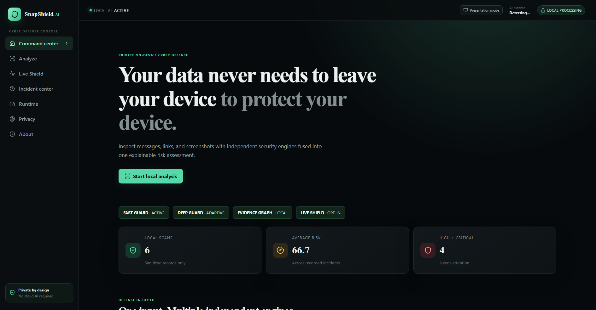
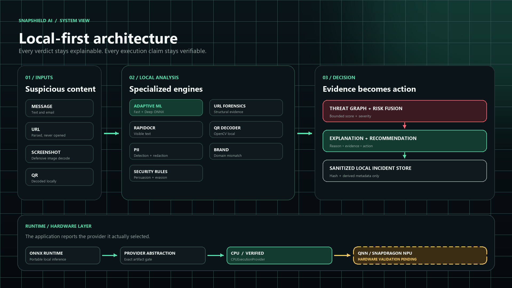
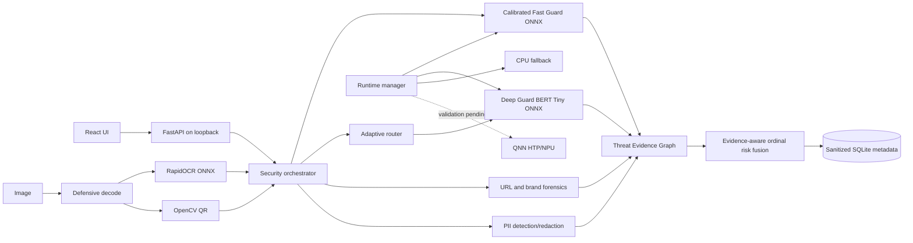
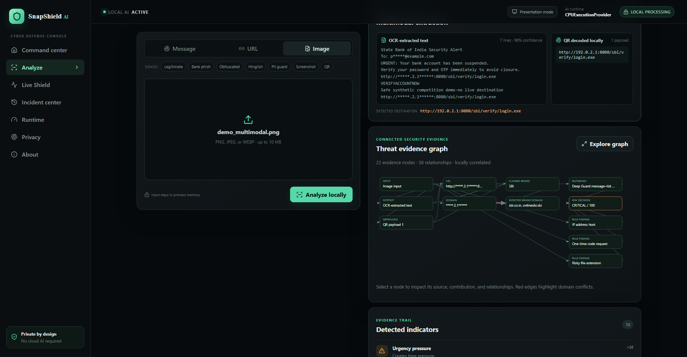
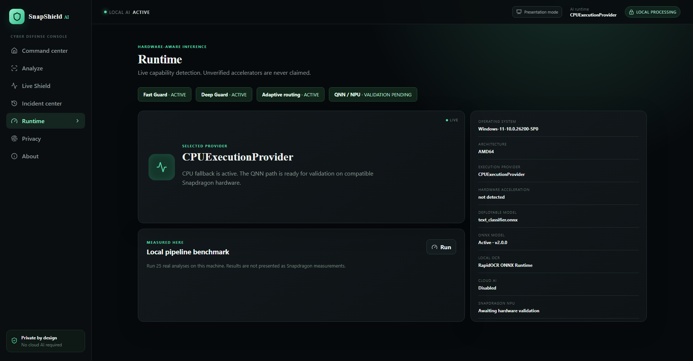

# SnapShield AI

> Private messages, links, and screenshots can be inspected without sending them to a cloud service.

SnapShield AI v2 is an adaptive, local-first multimodal cyber-defense platform for Windows and Snapdragon PCs. An ultra-light Fast Guard handles extreme-confidence cases; a compact Deep Guard examines ambiguous or contextual threats. URL forensics, OCR, QR decoding, brand/domain checks, PII redaction and deterministic security rules become a structured Threat Evidence Graph and an explainable action. Optional Live Shield can inspect newly copied text with explicit consent.

This repository is a working competition build. All analysis paths run locally after installation. It never visits submitted URLs, performs DNS lookups, executes payloads, or calls a cloud AI API.

**Verified now:** Fast and Deep ONNX inference with `CPUExecutionProvider`, 100 backend tests, 20/20 curated functional robustness checks, and independent UCI/cross-domain evaluation. Deep Guard reached 94.44% recall on the 766-message UCI test and 98.04% recall on the independently deduplicated 521-message 2022 Mendeley holdout. These are named SMS dataset results, not universal phishing accuracy. The Snapdragon/QNN validation workflow is implemented; hardware validation is pending.



## Competition submission

The v2 evidence source is [docs/v2](docs/v2/RESUME_STATE_AUDIT.md): start with the [model tournament](docs/v2/DEEP_GUARD_MODEL_TOURNAMENT.md), [adaptive router](docs/v2/ADAPTIVE_ROUTING.md), [cross-domain evaluation](docs/v2/CROSS_DOMAIN_EVALUATION.md), [claim ledger](docs/v2/CLAIM_LEDGER.md), and [limitations](docs/v2/LIMITATIONS.md). The frozen v1 submission documents remain historical baseline material.

## Verified capabilities

- Reproducible UCI SMS Spam Collection pipeline with checksum validation, pre-split exact/near deduplication, seeded stratification, and an untouched 766-message test set.
- Fast Guard calibration from development-only out-of-fold predictions plus a three-model compact neural tournament with a frozen edge-Pareto selection policy.
- Deep Guard BERT Tiny ONNX with hash-gated artifacts, calibrated probability, CPU fallback and 100% framework/ONNX class agreement across 766 validation messages.
- Adaptive routing that exposes its decision class/reasons and matched Deep Guard recall while invoking it on 33.68% of UCI test and 51.25% of external-set inputs.
- Local RapidOCR/ONNX Runtime text extraction from PNG, JPEG, and WEBP screenshots.
- Local OpenCV QR decoding; decoded URLs are analyzed but never opened.
- Offline Public Suffix List parsing, Unicode/IDNA normalization, controlled brand/domain mismatch, India-focused rules, and PII engines.
- Machine-readable Threat Evidence Graph, evidence-aware ordinal risk fusion, explanations, recommendations, and privacy-minimal SQLite incidents.
- Off-by-default Live Shield with explicit consent, clipboard deduplication/rate limiting, volatile alerts and explicit-only incident saving.
- React/TypeScript presentation mode with one-click real demo inputs and a truthful AI Runtime panel.
- Unsigned Windows one-folder build in `release/SnapShieldAI`.

## Fast + Deep ML results

Fast Guard preserves the v1 logistic model. The selected Deep Guard is BERT Tiny L2/H128, chosen before test access from three candidates because it remained within 0.01 of the best validation score while being dramatically smaller/faster. On the untouched 766-message UCI test:

Dataset attribution: **UCI SMS Spam Collection**, DOI [`10.24432/C5CC84`](https://doi.org/10.24432/C5CC84), licensed under **Creative Commons Attribution 4.0 (CC BY 4.0)**. See [DATASETS.md](DATASETS.md) for provenance, checksum, deduplication, and split details.

| Metric | Fast Guard (calibrated) | Deep Guard | Adaptive v2.2 |
|---|---:|---:|---:|
| Accuracy | 98.17% | 98.56% | 99.09% |
| Positive recall | 88.89% | 94.44% | 94.44% |
| Positive precision | 95.24% | 93.41% | 97.70% |
| Macro F1 | 95.46% | 96.55% | 97.76% |
| False-positive rate | 0.59% | 0.89% | 0.30% |
| False-negative rate | 11.11% | 5.56% | 5.56% |
| Deep escalation | — | 100% | 33.68% |

The external 2022 Mendeley holdout contains 521 independently retained records after strict UCI-overlap removal. Deep Guard achieved 98.04% recall and 0.63% FPR; Fast Guard achieved 68.63% recall and 0.63% FPR. See the cross-domain report for the disclosed adaptive-policy history and complete matrices.

## Architecture



<details>
<summary>Text version of the architecture</summary>



</details>

Detailed boundaries are in [ARCHITECTURE.md](ARCHITECTURE.md).

## Real multimodal evidence

The bundled synthetic screenshot is defensively decoded, read by local OCR, checked for a QR payload, and fused with text, URL, PII, brand/domain, and security-rule evidence. The decoded destination is displayed for inspection and is never opened.



## Quick start

Requirements: Python 3.11+ and Node.js 20.19+ or 22.12+.

```powershell
python -m pip install -r requirements.txt
cd frontend
npm install
npm run build
cd ..
python -m uvicorn backend.app.main:app --host 127.0.0.1 --port 8000
```

Open <http://127.0.0.1:8000>. The v2 desktop build binds only to `127.0.0.1:8766`. The package is not code-signed.

## Reproduce data, model, ONNX, and evaluation

```powershell
python scripts/v2/acquire_data.py
python scripts/v2/prepare_cross_domain.py
python scripts/v2/calibrate_fast_guard.py
python scripts/v2/train_deep_guard.py
python scripts/v2/finalize_deep_guard.py
python scripts/v2/evaluate_adaptive_router.py
python scripts/v2/run_functional_evaluation.py
python scripts/v2/benchmark_v2.py
python scripts/snapdragon/run_aihub_validation.py
```

The data step downloads only the official pinned UCI archive. Training selects on validation data, retrains on train+validation, and touches the test set once for the final report. The ONNX export compares every held-out test prediction with the scikit-learn reference.

## Verification

```powershell
python -m pytest
cd frontend
npm run lint
npm run typecheck
npm run build
npm audit --omit=dev
```

Final development-machine gate: 100 backend tests; frontend lint, strict TypeScript and production build; `pip check`; Python and npm production advisory audits. Current audit results contain no known vulnerabilities. See `reports/v2` for v2 machine-readable evidence.

## Runtime truth

This machine is Intel/AMD64 and exposes `AzureExecutionProvider` and `CPUExecutionProvider`; the deployed model selected `CPUExecutionProvider`. The FP32 ONNX model is verified. A calibrated QDQ candidate and an automated Snapdragon validation script exist, but QNN/HTP execution is **not verified** because native Windows ARM64 Snapdragon hardware and `QNNExecutionProvider` are unavailable here. No NPU speed or battery claim is made. See [SNAPDRAGON.md](SNAPDRAGON.md).



## API

| Method | Route | Purpose |
|---|---|---|
| GET | `/api/health` | Database, model, and provider state |
| GET | `/api/runtime` | Exact runtime, OCR, ONNX, and validation metadata |
| POST | `/api/analyze/text` | Full local text pipeline |
| POST | `/api/analyze/url` | Non-navigating URL forensics |
| POST | `/api/analyze/image` | Decode, OCR, QR, and security fusion |
| GET/DELETE | `/api/incidents` | Sanitized local incident history |
| GET | `/api/stats` | Aggregate statistics |
| POST | `/api/benchmark` | Interactive local text timing |

## Limits

- UCI SMS data is English, old, and spam-oriented; it does not cover all modern phishing or business-email-compromise patterns.
- The URL engine intentionally lacks live reputation, redirect expansion, and DNS context.
- OCR quality depends on image resolution/layout; a low score never guarantees safety.
- Brand matching is a deliberately small heuristic mapping, not a global brand registry.
- Risk contributions and severity bands are documented expert policy, not learned probabilities.
- QNN assignment, Snapdragon latency, energy use, and ARM64 packaging require target hardware.
- The Windows package is AMD64, one-folder, and unsigned.

Start a presentation with [DEMO_GUIDE.md](DEMO_GUIDE.md). Privacy, security, data, and third-party terms are documented in their dedicated files. Snapdragon is a trademark of Qualcomm Incorporated; its use does not imply endorsement.
