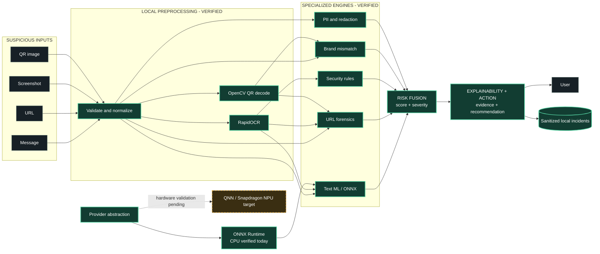
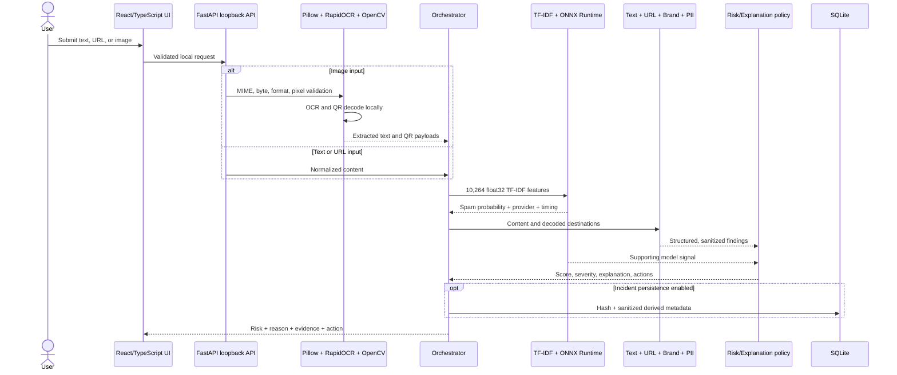
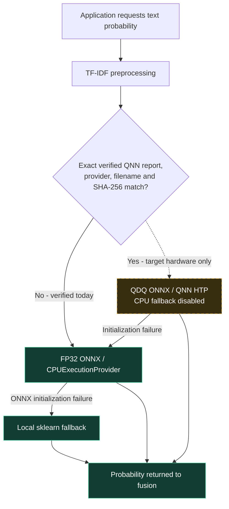
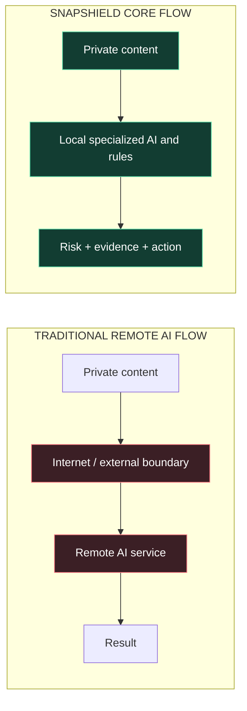

# Presentation architecture

## Presentation-friendly version

Use this graphic on slide 4. Solid green components are verified in the current build. The dashed amber branch is a target hardware path, not a completed NPU result.

Suggested legend:

- **Green / solid:** implemented and verified in the current build.
- **Amber / dashed:** implemented deployment direction awaiting target hardware validation.
- Current provider label: `CPUExecutionProvider`.

## Technical documentation version

### Inference-provider boundary

The QNN branch must remain visually labeled **hardware validation pending** until a named Snapdragon device passes the no-CPU-fallback validation script.

## Privacy architecture comparison

Accurate caption: **SnapShield's core analysis does not require cloud AI or URL network lookup after local installation.** This comparison describes architecture, not a claim that every remote service mishandles data.
